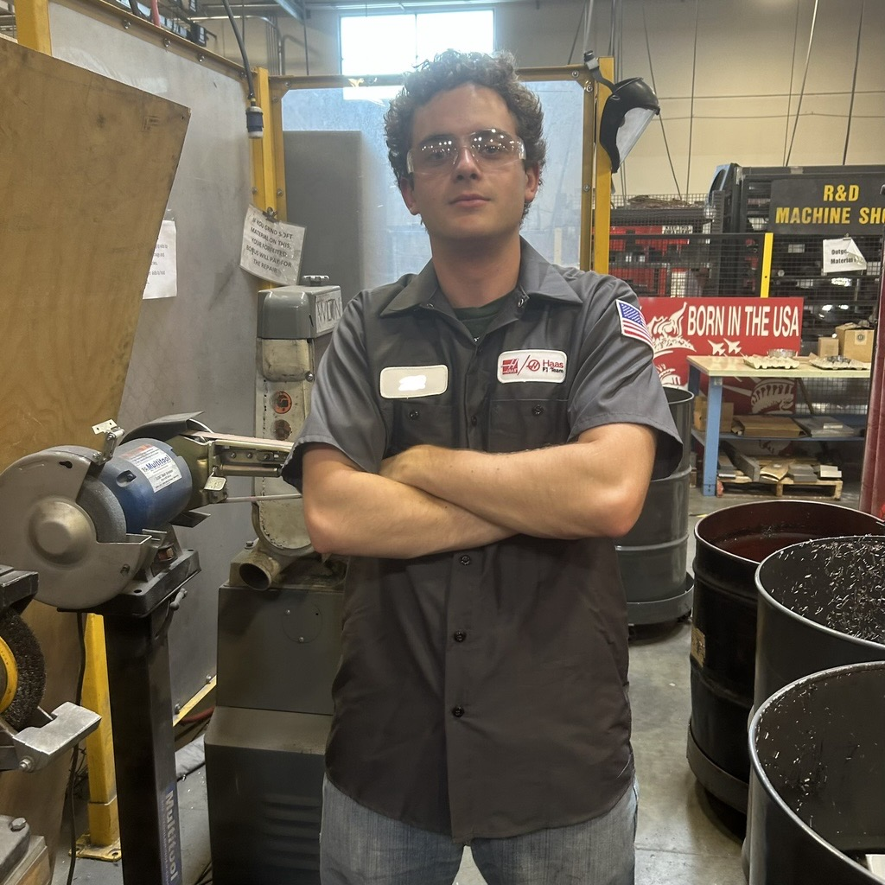

**Role:** What you were responsible for
**Team:** Solo, or team size
**Tools:** SolidWorks, ANSYS, etc.
**Timeline:** Fall 2025

## Problem
What needed to be solved and what the requirements were.

## Design process
Concepts considered, how you chose one, and key decisions.

{: .align-center}
*Early concept sketches*

## Analysis and testing
Calculations, FEA, test setup, and results. Tables work well here.

| Metric | Target | Result |
|--------|--------|--------|
| Factor of safety | 2.0 | 2.4 |

## Results
What you built, how it performed, and with photos or renders.

## What I'd do differently
Lessons learned and next steps.